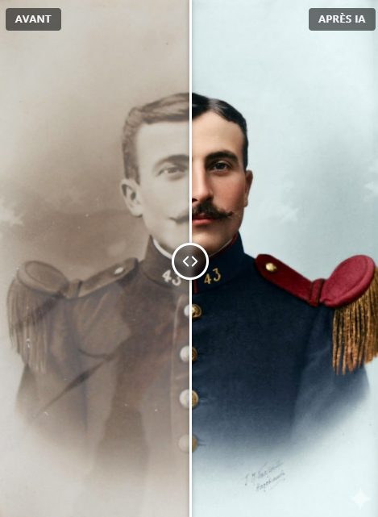

# WP Then Now Slider

Before / after photo comparison slider for WordPress: create unlimited comparisons, display them with a shortcode or a Gutenberg block.

<p align="center">
  
  <br><em>An old portrait compared with its AI-restored version / Un portrait ancien comparé à sa version restaurée par IA</em>
</p>

*Version française plus bas.*

## Features

- Unlimited saved comparisons, each with its own shortcode
- Gutenberg block (pick a saved comparison or two images)
- **Layouts:** horizontal, vertical, reversed order
- **Display modes:** drag the handle, follow the mouse, click to switch, side by side
- **Handle:** 4 styles (circle, square, arrows, line), always visible / on hover / hidden
- **Filters:** black & white, sepia, vintage, warm, cool, high contrast, vivid colors, blur
- **Watermark** (image or text), **badge**, **detailed caption** (below or over the image)
- **Fullscreen** button (native, simulated on iPhone)
- Labels that fade out when the handle passes over them
- Global or per-comparison colors — handle color and selection color (defaults to the theme color)
- Mouse, touch and keyboard support, accessible `role="slider"`
- No jQuery on the front end, no build step, assets loaded only where needed
- English and French included, translation ready

## Installation

1. Download the latest release zip (or **Code > Download ZIP** and rename the folder to `wp-then-now-slider`).
2. WordPress admin: **Plugins > Add New > Upload Plugin**, then activate.
3. Go to **Before / After > Add New**.

## Usage

```text
[then_now id="12"]
[then_now before="123" after="456" orientation="vertical" start="30"]
[then_now id="12" mode="click" before_filter="grayscale" badge_text="2024" fullscreen="yes"]
```

| Attribute | Values | Default |
|---|---|---|
| `id` | saved comparison ID | – |
| `before`, `after` | media ID or image URL | – |
| `before_label`, `after_label` | text | Before / After |
| `before_alt`, `after_alt` | text | media alt |
| `labels` | `yes`, `no` | `yes` |
| `mode` | `slider`, `hover`, `click`, `side` | `slider` |
| `orientation` | `horizontal`, `vertical` | `horizontal` |
| `reverse` | `yes`, `no` | `no` |
| `start` | 0–100 | `50` |
| `handle_style` | `circle`, `square`, `arrows`, `line` | `circle` |
| `handle_visibility` | `always`, `hover`, `hidden` | `always` |
| `fullscreen` | `yes`, `no` | `no` |
| `color` | hex color | global setting |
| `focus_color` | hex color | global setting / theme |
| `before_filter`, `after_filter` | `none`, `grayscale`, `sepia`, `vintage`, `warm`, `cool`, `contrast`, `saturate`, `blur` | `none` |
| `watermark_image` | media ID | – |
| `watermark_text` | text | – |
| `watermark_position` | `top-left`, `top-center`, `top-right`, `bottom-left`, `bottom-center`, `bottom-right`, `center` | `bottom-left` |
| `watermark_opacity` | 5–100 | `60` |
| `badge_text` | text | – |
| `badge_position` | same as watermark (except `center`) | `top-center` |
| `badge_color` | hex color | selection color |
| `caption` | text, basic HTML | – |
| `caption_position` | `below`, `overlay` | `below` |
| `class` | CSS class | – |

With `id`, any other attribute overrides the saved setting.
Content loaded with AJAX: `window.WPThenNowSlider.init(container)`.

## Upgrading from "Avant Après Slider" / "Before After Slider" 1.x

Deactivate and delete the old plugin, then install this one. On activation, comparisons, global colors and blocks are migrated automatically. Old `[avant_apres]` / `[before_after]` shortcodes keep working.

## Structure

```text
wp-then-now-slider/
├── wp-then-now-slider.php   # plugin (post type, shortcode, block, admin)
├── assets/
│   ├── css/style.css        # front end + editor
│   ├── css/admin.css
│   ├── js/slider.js         # front end slider (vanilla JS)
│   ├── js/block.js          # Gutenberg block (no build step)
│   └── js/admin.js          # media picker, color pickers
└── languages/               # .pot, fr_FR .po/.mo/.json
```

## License

GPL-2.0-or-later — see [LICENSE](LICENSE).

---

## Français

Slider de comparaison de photos avant / après pour WordPress. Créez autant de comparaisons que vous voulez dans **Avant / Après > Ajouter**, puis affichez-les avec le shortcode `[then_now id="12"]` ou le bloc Gutenberg « Avant / Après ».

- Dispositions : horizontale, verticale, ordre inversé ; modes glisser, survol, clic pour basculer, côte à côte
- Poignée : 4 styles, visible / au survol / masquée
- Filtres d'image, filigrane (image ou texte), badge, légende détaillée, bouton plein écran
- Couleurs globales (**Avant / Après > Réglages**) ou propres à chaque comparaison
- Couleur de sélection de la poignée = couleur du thème par défaut
- Interface en français si WordPress est en français, sinon en anglais
- Les anciens shortcodes `[avant_apres]` et `[before_after]` fonctionnent toujours
